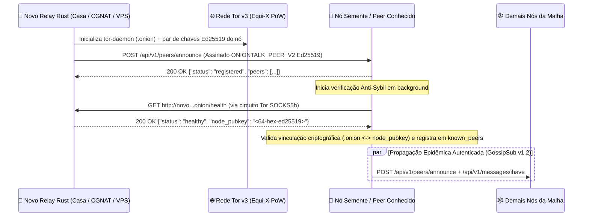
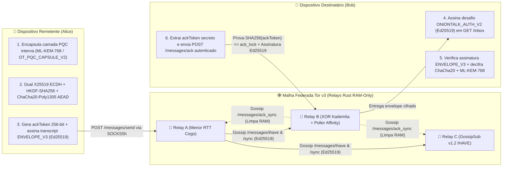

# 🧅 MANIFESTO ONIONTALK
**Privacidade Absoluta, Malha Federada Zero-Trust e Resistência Incondicional à Censura**

> *"A privacidade é necessária para uma sociedade aberta na era eletrônica. Privacidade não é segredo. Um assunto privado é algo que alguém não quer que o mundo inteiro saiba, mas um assunto secreto é algo que ninguém deve saber. A privacidade é o poder de se revelar seletivamente ao mundo."*
> — **Eric Hughes**, *A Cypherpunk's Manifesto (1993)*

> **Aviso de Transparência sobre o Código-Fonte**: O servidor Relay federado em Rust (`oniontalk-relay`) e a especificação técnica do protocolo [`ENVELOPE_V3` (`docs/PROTOCOL.md`)](./PROTOCOL.md) são 100% open-source sob licença MIT. O código-fonte dos aplicativos clientes (`org.oniontalk.messenger`, `onion-talk-web` e iOS) permanece **bloqueado/fechado temporariamente** durante o ciclo atual de hardening criptográfico e estabilização pré-auditoria.

---

## 1. Por Que o OnionTalk Existe (Tese Fundamental)

Mensageiros modernos falham no teste mais básico da soberania digital: **eles exigem que você entregue sua identidade civil (número de telefone, SIM card, e-mail, IP e metadados de rede) em troca da promessa de que seus servidores centrais não serão comprometidos, coagidos ou bloqueados.**

Mesmo quando o conteúdo da mensagem é criptografado ponta a ponta, a infraestrutura tradicional permanece centralizada:
1. **Identidade Vinculada ao Estado/Operadora**: Seu identificador é um número de telefone sujeito a SIM Swapping, intimações e rastreamento de grafo social.
2. **Ponto Único de Censura (DNS & IP)**: Basta bloquear os IPs ou domínios DNS de um provedor central (ou remover o aplicativo de um barramento de Push como Google FCM) para silenciar milhões de pessoas.
3. **Servidores Confiáveis por Premissa**: O roteamento centralizado sabe *quem* falou com *quem*, *quando*, *com que frequência* e *a partir de qual endereço IP*.

O **OnionTalk (`org.oniontalk.messenger`)** foi construído para erradicar essas três vulnerabilidades na raiz. Ele substitui a confiança institucional por **provas criptográficas assimétricas pós-quânticas (`ML-KEM-768 + X25519`), memória volátil em RAM e roteamento oculto em malha sobre a rede Tor v3**.

---

## 2. Os 5 Mandamentos Arquiteturais do OnionTalk

1. **Zero PII (Identidade Criptográfica de 256 bits)**: Nenhuma conta exige telefone, e-mail, SMS ou cadastro central. Sua identidade é uma chave pública **Ed25519 de 256 bits (64 caracteres hexadecimais)** no formato `@<64_hex_ed25519_pubkey>:<dominio>.onion`, mapeada birracionalmente para **X25519** (`RFC 7748 / RFC 8032`) e emparelhada com chaves pós-quânticas **NIST FIPS 203 ML-KEM-768**.
2. **Zero-Trust nos Relays**: Qualquer pessoa pode operar um servidor Relay do OnionTalk (`oniontalk-relay-rs`, Rust nativo non-root `UID 10014`). Por isso, o protocolo trata **todos os servidores como potencialmente hostis**. Um relay não consegue ler mensagens, não consegue adulterar `msgId`, `timestamp` ou `ack_lock` (vinculados na assinatura `ENVELOPE_V3`), exige assinatura **Ed25519** do destinatário para consultar o `/inbox` e exige prova criptográfica de pré-imagem (*ACK Preimage Lock*) para apagar mensagens.
3. **Zero Disco para Mensagens nos Servidores (RAM-Only Store-and-Forward)**: Relays nunca gravam mensagens ou envelopes decifrados em banco de dados ou disco (`ram-volatile-ephemeral-ttl24h`). As filas existem exclusivamente em `DashMap` na memória RAM volátil com expiração automática (24h para mensagens, 30s para quadros de voz) e são destruídas instantaneamente no momento do `ACK`.
4. **Zero Clearnet / Zero Vazamento de DNS**: Todo o transporte ocorre via **Tor Hidden Services v3 (`.onion` de 56 caracteres Ed25519)** usando handshake `SOCKS5h` (`ATYP=0x03`, `IsolateDestAddr`), reforçado por **Tor 0.4.9 Equi-X PoW** (`HiddenServicePoWDefensesEnabled 1`) e `IntroDoS` contra negação de serviço.
5. **Negabilidade Plausível e Autodestruição Forense**: Se o dispositivo físico for apreendido sob coerção, o cofre **SQLCipher AES-256** (derivado via **Argon2id `19 MiB, t=2, p=1`**, backups `OTBK3`) conta com trituração física DoD 2-pass (*Duress Wipe*) após 5 tentativas inválidas, proteção de tela obrigatória (`FLAG_SECURE`) e comando de queima sincronizada ponta a ponta (*Burn Chat* com *watermarks* monotônicas).

---

## 3. Como Funciona o Service Discovery (Auto-Gossip PEX, S/Kademlia XOR & Anti-Sybil)

Em uma rede verdadeiramente descentralizada e anônima, novos servidores não podem depender de DNS central nem de registros públicos de IP. O OnionTalk implementa **Service Discovery Epidêmico Autenticado (`Auto-Gossip PEX`)**, **roteamento por distância XOR (S/Kademlia)** e **GossipSub v1.2 (`IHAVE`/`IDONTWANT`)** sobre a rede Tor v3:



### Implementação de Referência em Rust ([`src/main.rs`](../src/main.rs) & [`src/crypto.rs`](../src/crypto.rs)):
* **Auto-Identificação Criptográfica**: Ao subir com `docker compose up -d`, o daemon Tor gera seu par Ed25519 no volume `/data/hidden_service` (`0700`) e o binário `oniontalk-relay-rs` carrega sua identidade `.onion` e chave `node_pubkey` (`0600` atômico).
* **Handshake Ativo Anti-Sybil**: O relay receptor valida a gramática v3 (`^[a-z2-7]{56}\.onion$`), a assinatura `ONIONTALK_PEER_V2`, os limites `MAX_KNOWN_PEERS = 64` / `MAX_AUTO_PEERS_PER_PROVIDER = 6` e executa `GET http://<candidato>.onion/health` sobre Tor antes de admitir o nó.
* **Seleção Zero-Master por RTT Cego**: Os clientes elegem gateways medindo apenas o RTT fim-a-fim do circuito Tor (EWMA) — sem GeoIP, GPS ou hierarquia fixa.
* **PKI com Offline Root CAs (`otcrl1:`)**: A governança de emissores confiáveis utiliza raízes offline pinadas (`OFFLINE_ROOT_CA_PUBKEYS`), tokens com expiração obrigatória (máx. 35 dias) e listas assinadas de revogação/delegação `otcrl1:` com *epoch* monotônico ([`src/founder.rs`](../src/founder.rs)).

---

## 4. Como as Mensagens São Cifradas e Distribuídas (`ENVELOPE_V3` + `ML-KEM-768`)



Para os formatos binários exatos, transcripts de assinatura e especificações de endpoints, consulte [**`docs/PROTOCOL.md`**](./PROTOCOL.md).

---

## 5. Engenharia Anti-Bloqueio e Anti-Forense

| Vetor de Censura / Ataque | Como Mensageiros Comuns Falham | Como o OnionTalk Neutraliza |
| :--- | :--- | :--- |
| **Bloqueio de DNS (Sinkholing / Poisoning)** | Operadoras bloqueiam a resolução do domínio central. | **Zero DNS Local (`SOCKS5h ATYP=0x03`)**: Resolução criptográfica do descritor `.onion` estritamente dentro do circuito Tor. |
| **Bloqueio de IP (BGP / DPI) e DDoS** | Governos bloqueiam faixas de IP ou derrubam servidores centrais. | **Tor v3 Rendezvous + Equi-X PoW + IntroDoS**: Nenhum IP é exposto; defesa nativa contra flood de circuitos no Tor 0.4.9. |
| **Derrubada de Nó Central (SPOF)** | Se o cluster principal cair, o serviço inteiro sai do ar. | **Malha Zero-Master Multi-Provedor**: Seleção por RTT cego no Tor + espelhamento entre provedores distintos + `IHAVE/IDONTWANT`. |
| **Adulteração por Nó Malicioso / Replay** | Um servidor malicioso tenta ler, reenviar ou corromper envelopes. | **`ENVELOPE_V3` + `ML-KEM-768` + Preimage Lock**: Assinatura Ed25519 vincula `msgId`, `timestamp` e `ack_lock`; `ACK` exige pré-imagem SHA-256 em tempo constante; nullifiers anti-replay. |
| **Coerção Física e Perícia no Aparelho** | Peritos extraem páginas SQLite deletadas, EXIF ou forçam desbloqueio. | **SQLCipher AES-256 + Argon2id (`19 MiB`)**: Remoção de 100% de EXIF/GPS com *LSB jitter*, `FLAG_SECURE` obrigatório, *Burn Chat* bilateral com watermark e *Duress Wipe* DoD 2-pass. |

---

## 6. Convocação: Fortaleça a Malha

Qualquer pessoa com Docker instalado — em um Raspberry Pi, servidor caseiro atrás de CGNAT, NAS ou VPS — pode lançar um novo nó federado do OnionTalk em menos de 60 segundos:

```bash
git clone https://github.com/onion-talk/oniontalk-relay.git
cd oniontalk-relay
docker compose up -d --build
```

Sem cadastro. Sem pedir permissão. Sem abrir portas no roteador.
**Sua chave. Seu nó. Sua palavra.**
